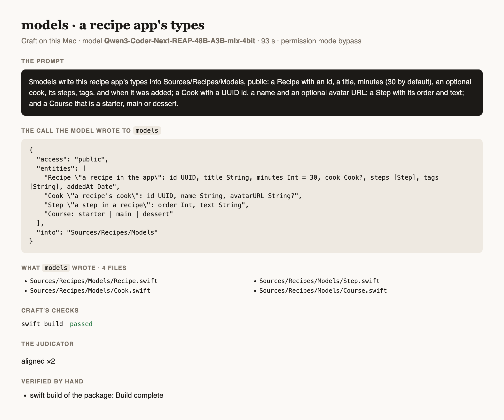

# Testing ModelsAgent

How `models` is tested: its own suite, its gated build of real output, and prompts run through
[Craft](https://github.com/riteshpakala/Craft) on a Mac with Craft's own local model, each logged below verbatim with
what came out. A prompt is run as a person would type it, in a project folder, with `$` naming the agent; nothing is
edited between the prompt and the screenshots. A test that needs a server uses mock backend responses, never a live
service.

## The suite

```
swift test                                  # the record, the schema, the lines, the files, a call through the roster
MODELS_BUILD=1 swift test --filter ModelsBuildTests   # the output built for real (gated, minutes)
```

## Prompts run on this Mac

Setup: MacBook Pro M4 Max (128 GB), macOS 27, Xcode 27.1, Craft built from `main`, the model Craft loads
(`rao-studios/Qwen3-Coder-Next-REAP-48B-A3B-mlx-4bit`), permission mode bypass, the agent installed from this repository
with `craft agents add`.

### 1. A recipe app's types, public, in a Swift package

*2026-11-01 · Qwen3-Coder-Next-REAP-48B-A3B-mlx-4bit · 93 s*

**The prompt**, verbatim:

```text
$models write this recipe app's types into Sources/Recipes/Models, public: a Recipe with an id, a title, minutes (30 by default), an optional cook, its steps, tags, and when it was added; a Cook with a UUID id, a name and an optional avatar URL; a Step with its order and text; and a Course that is a starter, main or dessert.
```

**The call the model wrote** to `models`:

```json
{
  "access": "public",
  "entities": [
    "Recipe \"a recipe in the app\": id UUID, title String, minutes Int = 30, cook Cook?, steps [Step], tags [String], addedAt Date",
    "Cook \"a recipe's cook\": id UUID, name String, avatarURL String?",
    "Step \"a step in a recipe\": order Int, text String",
    "Course: starter | main | dessert"
  ],
  "into": "Sources/Recipes/Models"
}
```

**What `models` wrote** (4 files): `Sources/Recipes/Models/Recipe.swift`, `Sources/Recipes/Models/Cook.swift`, `Sources/Recipes/Models/Step.swift`, `Sources/Recipes/Models/Course.swift`

**Craft's checks**: `swift build` passed

**The judicator**: aligned ×2

**Verified by hand**:
- `swift build` of the package: Build complete


*The outcome card: the prompt, the call, the files and the checks*

**Notes**:
- The model wrote a correct call on its first try from the guide alone; it chose `avatarURL String?` where the prompt said an avatar URL, a reasonable reading.
